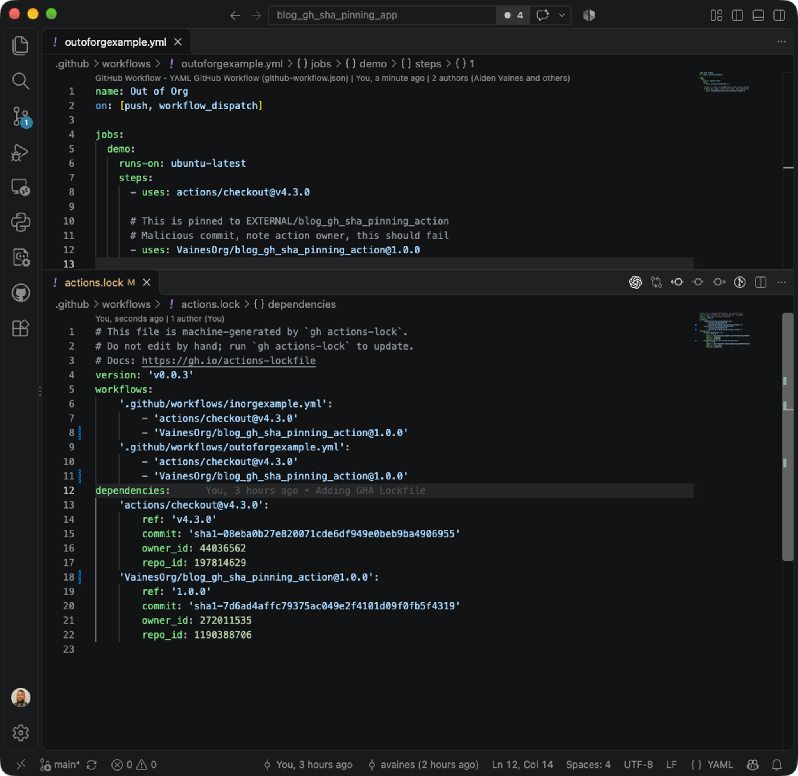
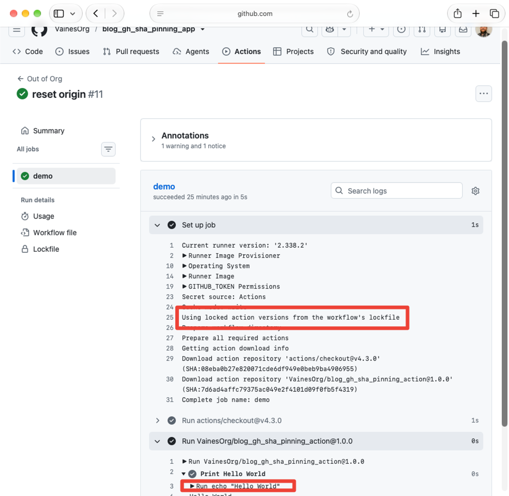
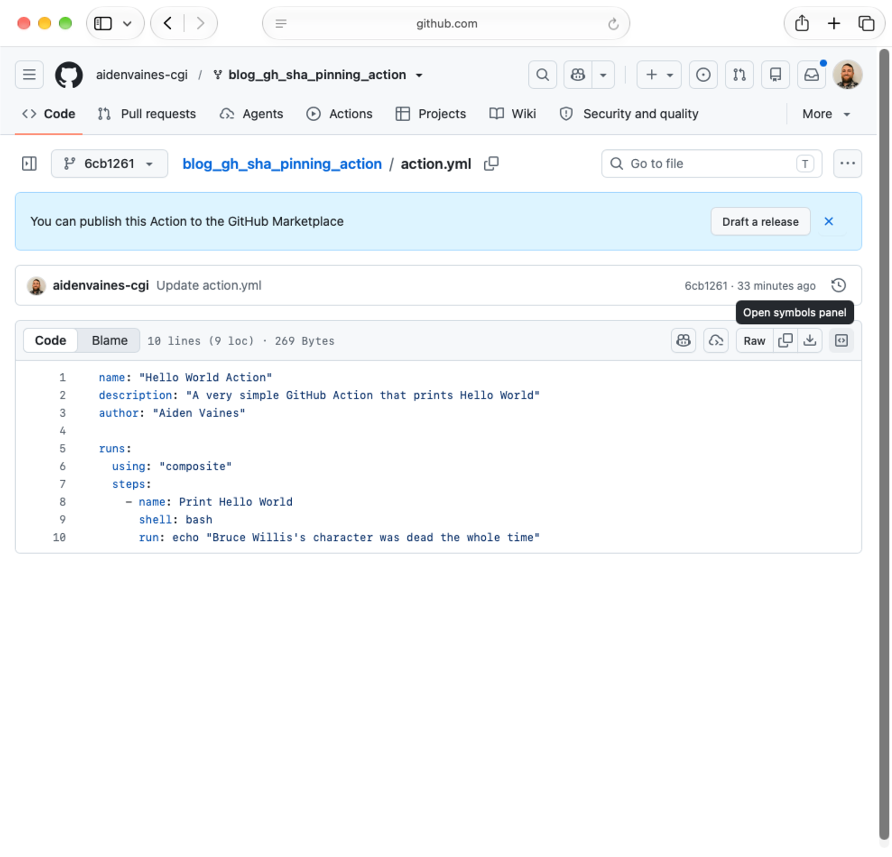
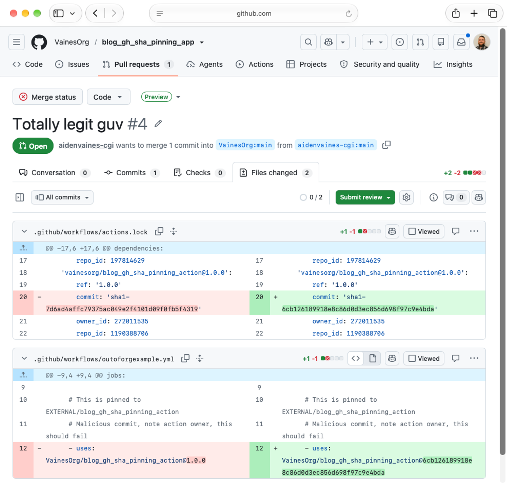
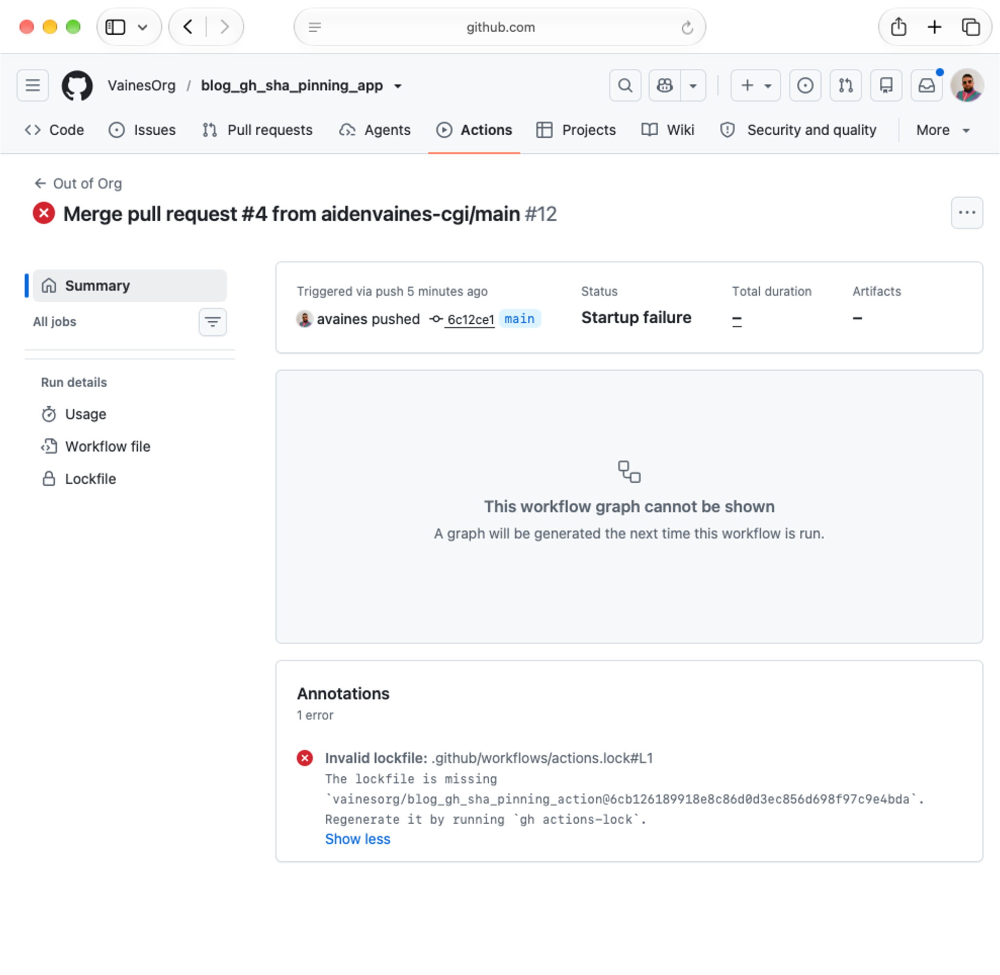
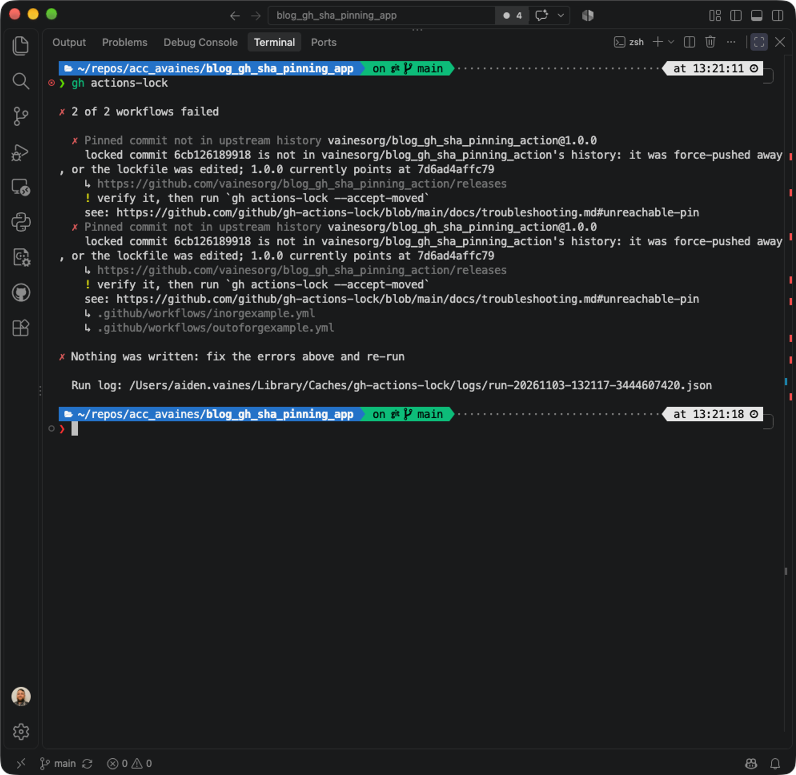

Back in March, I wrote [The Comforting Lie of SHA Pinning](/posts/2026-03-24-the-comforting-lie-of-sha-pinning/), after spending rather too much of my Monday investigating the supply-chain compromise with Trivy and discovering something worrying about how GitHub Actions resolves dependencies.

Ultimately, the problem was that pinning an Action to a full commit SHA, as GitHub's own security guidance recommended, didn't actually ensure you were executing code from the repository you thought you were. An attacker can fork a legitimate Action, introduce a malicious commit and convince someone to update the SHA in an otherwise normal-looking workflow. GitHub would happily resolve that commit through the original repository's fork network and execute it, even with organisation allowlists and mandatory SHA pinning in place.

I couldn't believe it, so I wrote the original post, then spoke about it at [DevOps Notts](/talks/2026-08-25-devops-notts-sha-pinning/) and I'm talking about it again on Thursday at [Yorkshire DevOps](/talks/2026-11-05-yorkshire-devops-sha-pinning/).

Well, on 28 October 2026, GitHub [announced the general availability of workflow dependency lockfiles](https://github.blog/changelog/2026-10-28-github-actions-workflow-lockfiles-are-generally-available/).

I'd like to think my blog post was instrumental in bringing about this change. GitHub has yet to confirm this or provide any sort of trophy. Some may say the feature was already in public preview or Chainguard and many others have been highlighting this for years, but I believe I deserve the full credit anyway.

## A lockfile. Imagine that.

My complaint wasn't that commit SHAs were insecure. They're a perfectly sensible way to identify a specific piece of code. The problem was that GitHub wasn't enforcing where that code came from — its provenance — instead leaving the responsibility for validating provenance with whoever reviewed the workflow.

Humans are reasonably good at recognising names and versions. We're considerably less good at spotting the wrong character in a 40-character hexadecimal string.

The new `.github/workflows/actions.lock` file records the resolved commit alongside the repository identity. You can keep readable references in your workflows too:

```yaml
- uses: VainesOrg/blog_gh_sha_pinning_action@1.0.0
```

While the generated lockfile records the actual dependency:

```yaml
'VainesOrg/blog_gh_sha_pinning_action@1.0.0':
  ref: '1.0.0'
  commit: 'sha1-7d6ad4affc79375ac049e2f4101d09f0fb5f4319'
  owner_id: 272011535
  repo_id: 1190388706
```



GitHub can now check that the commit is reachable through the expected repository and reference, rather than simply accepting a Git object somewhere in its fork network. There's more information in [GitHub's workflow dependency lockfile documentation](https://docs.github.com/en/actions/concepts/security/workflow-dependency-lockfiles).

It also handles transitive Action dependencies, integrates with Dependabot and supports policies requiring lockfiles.

All rather sensible. It's a shame we had to wait until 2026 when Ruby had this in 2010.

## But does it work?

I still had the repositories from my original experiment, so I enabled workflow dependency locking and tried the same attack.

I generated the lockfile using `gh actions-lock` and ran the original workflow. Everything behaved as expected, including a rather pleasing message in the runner logs confirming it was using locked Action versions. *The error messaging could use some work.*



Then I created another malicious commit in my fork of the legitimate canonical Action.



I raised a pull request replacing the legitimate Action's reference with the malicious fork commit. I also modified the corresponding entry in `actions.lock`, retaining the legitimate repository identity.



Previously, approving this change would have resulted in GitHub executing my malicious Action.

This time it refused to start the job. *Huzzah!*

The runner rejected the lockfile, reporting that the requested commit wasn't present in the locked dependency.



I also tried regenerating the lockfile locally using `gh actions-lock`, just in case the tooling would happily accept the malicious SHA and produce a new valid lockfile.

Nope. It reported **"Pinned commit not in upstream history"**, identified the mismatch and refused to write the lockfile. *Fantastic.*



That's considerably better than telling engineers to check 40-character strings more carefully.

## So we're all safe now, right?

Obviously not. Lockfiles don't make a malicious dependency trustworthy, and if a legitimate upstream release is compromised, you can still end up executing malicious code but that's an entirely different risk for a third-party plugin ecosystem.

You still need to restrict permitted Actions, protect workflow changes, minimise permissions and use short-lived credentials wherever possible. There are also limitations, including external reusable workflows, which aren't covered by the caller's lockfile.

But the specific forked-commit substitution I demonstrated in March is now prevented when workflow dependency locking is enforced. Which is a proper improvement, and the solution to the problem that I (and basically everyone else) proposed. GitHub has implemented a technical control that addresses the problem rather than continuing to make it the customer's responsibility to spot malicious changes.

I'm giving my talk on [The Comforting Lie of SHA Pinning at Yorkshire DevOps this Thursday, 5 November](/talks/2026-11-05-yorkshire-devops-sha-pinning/), which means I've had to hurriedly update the presentation to explain that GitHub has actually fixed the thing I've spent the last six months complaining about.

At least it has a happier ending now.

I'm still taking credit, though.
