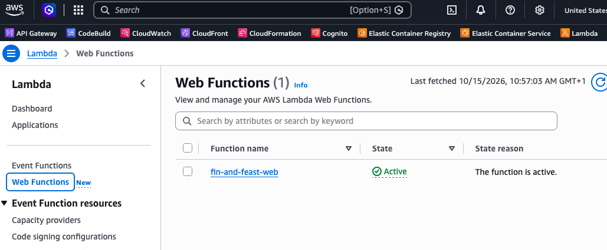
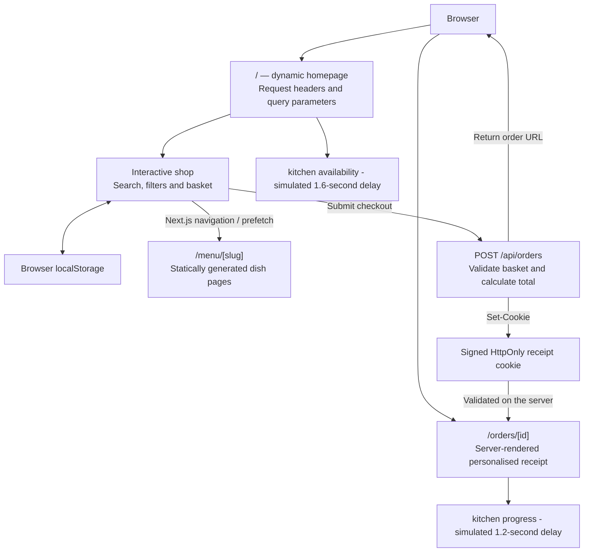

This week, AWS have announced [Lambda Web Functions](https://aws.amazon.com/blogs/aws/announcing-aws-lambda-web-functions-for-fast-consistent-web-app-performance-anywhere/), which, after fighting with Amplify for the last few years, made me drop what I was doing and have a play.

I was excited about this because as much as the JS community seems to be hell-bent on finding another way of running JavaScript and more JavaScript frameworks running Next.Js outside of Vercel isn't the best experience. I've been running Next.js on AWS Amplify for a couple of years, and I would quite like to stop doing that. It sucks.

Next.js seems like a decent framework, particularly when you want to mix static pages with server-side rendering, dynamic routes and a bit of server-side application logic. If you're deploying to Vercel, the whole thing is a pretty slick experience. Which isn't terribly surprising, given Vercel's relationship with Next.js. Hosting it elsewhere is ... interesting.

If you're just using what could be hosted as a static site, fine. But why bother with Next.js at all? Easily hosted and known patterns abound for this. As soon as you want the funky routing, [SSR][ssr], or on-demand [ISR][isr] bits, it's pain time.

Obviously we looked at containers where ECS would do the job, but it seemed like a lot of plumbing just to host a web application. We also looked at splitting the server-side bits out into Lambda. That's perfectly possible, especially with projects like [OpenNext](https://opennext.js.org/) making it easier, but it still means owning rather more of the integration than we wanted to at the time.

Amplify appeared to be the least worst option; we just needed to connect the repository, let AWS build and deploy Next.js, get a CDN and managed SSR infrastructure thrown in. Having this work in a sensible [SDLC][sdlc] in an enterprise has been a bit challenging. Like many of the higher-level AWS managed services, it seems to forget all the patterns and prescriptive guidance about promoting through environments and accounts in favour of the target audience being smaller teams or singular developers having a click-and-go with built-in dev and release options. Compared with maintaining our own hosting arrangement, Amplify sounded quite sensible.

[ssr]: ## "Server Side Rendering"
[isr]: ## "Incremental Static Regeneration"
[sdlc]: ## "Software Delivery LifeCycle"

## Lets build some stuff...

The Amplify infrastructure-as-code experience is shite. Between provider limitations, gaps in the APIs and behaviour that isn't documented particularly well (or at all), I've spent far too much time working around the Amplify platform rather than building applications. We've encountered things that behave differently depending on whether they were configured through the API or clickOps'd in the console. That's particularly irritating when you're trying to keep environments reproducible.

When something goes wrong, which it will, debugging can be equally unpleasant - *though I will say it has gotten a lot better recently*. You know that something somewhere in the managed deployment black-box isn't behaving, but getting enough information to understand *what* is happening feels like an archaeological expedition.

Even the mundane stuff gets weird: [AWS documents that Amplify environment variables aren't automatically available to Next.js server components](https://docs.aws.amazon.com/amplify/latest/userguide/ssr-environment-variables.html). You have to **explicitly** write the ones you need into the Next.js environment configuration during the build. I get the security rationale, but it's another Amplify-specific detail to remember when you thought you were just deploying a Next.js app.

And then there are the framework features. At the time of writing, [Amplify's Next.js support documentation](https://docs.aws.amazon.com/amplify/latest/userguide/ssr-amplify-support.html) lists support through Next.js 15, but specifically excludes Next.js streaming and on-demand ISR. Those aren't the only features in Next.js, and to be fair to Amplify, it handles plenty of other things nicely, including static delivery. But after years of dealing with the awkward bits, I was stoked to read I might have an alternative to it.

## Demo time!

After reading the news post I quickly sent an AI agent off to throw a small Next.js application together which used routing, ISR, and SSR along with some other bits. I deployed exactly the same code to Amplify and Lambda Web Functions, then ran a battery of tests over them repeatedly with Playwright to see what happened. There's a copy of all the code in the linked GitHub repo if you want to run your own tests.

Traditional Lambda, or as AWS now call it **Lambda Event Functions**, gives your code an event and expects a response. A normal Next.js production server doesn't work like that; it listens on an HTTP port and serves requests. Getting it onto traditional Lambda just wouldn't work very well with that difference.

A Lambda Web Function, on the other hand, seems to be simply running an HTTP server. Your application listens on the host and port supplied by Lambda, and AWS provides the HTTPS endpoint, execution environments, and scaling. No API Gateway nonsense pretending to be an HTTP request and no framework-specific adapter to get a standard Node server running.

The docs show some other interesting changes too! A warmed Web Function can serve multiple requests at once, rather than the single concurrent invocation model we're used to with ye old Event Functions. AWS allows an upper bound of [up to 128 concurrent requests per environment](https://docs.aws.amazon.com/lambda/latest/dg/web-functions-scaling.html), although the actual concurrency is apparently managed dynamically. This could be handy for web applications which spend a good deal of time waiting for other stuff like databases or whatever other AWS services you plumb in.

The billing model is cool as well; Web Functions meter active CPU time, alongside memory over the lifetime of the environment, requests and data transfer. Waiting for databases or whatever doesn't consume much CPU, even though the environment still has memory allocated. Whether that's cheaper for a particular Next.js application is another question entirely, but it sounds good for the use case.

Oh, AND Web Functions support *native response streaming*, which is a feature I really wanted to get my greasy mitts on.

At launch, this is [Node.js 24 on Arm64](https://docs.aws.amazon.com/lambda/latest/dg/web-functions.html), not a general-purpose way to run absolutely anything, and AWS also has immutable revisions, endpoints that can direct traffic to revisions, and optional multi-region routing. Quite a lot of toys straight out of the box for something that looks much more like deploying an ordinary web server.

Of course, an HTTP endpoint and some compute aren't the same thing as a complete managed Next.js hosting platform. But we can worry about that after we've made some fish.

## Just Eat...but for fish

*Uber but for dogs* is so passé. If any investors are reading, we should talk 🤙

I wanted to exercise the actual Next.js behaviour I wanted to play with rather than just a simple Next.js starter page, deploy it twice and declare victory because both returned a 200.

So I (*Codex GPT 6 Astra*) built **Fin & Feast**, a fictional takeaway service offering fish delivered to your door. Searchable menus, dish pages, a working basket, checkout and order tracking mock. It looks enough like a real little application to be suitable for testing some of these toys out.

The app uses Next.js 15, TypeScript and the App Router. There's one codebase and two hosting targets, with all the source, Terraform and benchmarking code attached to the top of this post.

The homepage renders dynamically using details from the request. The individual dish pages are statically generated. Checkout goes through `/api/orders`, where the basket is validated and prices are calculated on the server. The order confirmation is personalised using a signed, HttpOnly receipt cookie, which the server checks when you open the order page.

There's no database or payment integration. The basket lives in browser storage, and checkout is simulated as this is just a hosting experiment. The signed receipt means you can't just guess someone else's order URL and read their order, but it isn't meant to be a production commerce system.

The homepage availability panel and the order progress panel are asynchronous components behind React Suspense boundaries. I've deliberately added a second or so of delay to availability and order progress to simulate some waiting. These delays are there to make the difference between *streaming a page as pieces become ready* and *waiting until everything is ready* obvious. It's not supposed to be a benchmark of database performance or a claim about how long Lambda takes to run JavaScript or any of that.

## One app to rule them all

Both deployments have IaC written in Terraform and given that I said IaC is one of the things that's made Amplify so painful, it made sense to include that.

For Amplify, Terraform sets up the application and connects it to the GitHub repository. Amplify does its thing and builds the Next.js app from `app/` and deploys it using its managed hosting setup. Importantly, that includes a CloudFront distribution somewhere in the AWS-managed bit.

For Web Functions, that all becomes your problem to deal with. The Next.js app is built in standalone mode from a Linux Arm64 build container which packages the generated Node server and its assets into a ZIP, and uploads that to an S3 bucket. Terraform creates a Web Function revision pinned to that object version and points an HTTPS endpoint at the revision. A tiny entry point tells Next.js which host and port to listen on.

That container is just for the build; the application is running as a native Web Function, not as another container service, meaning Corey Quinn doesn't get to update his [17 ways to run containers in AWS post](https://www.lastweekinaws.com/blog/the-17-ways-to-run-containers-on-aws/) today.

I think one of the biggest caveats to this setup is that CloudFront distribution Amplify is bundling in with its managed service wrap. Web Functions doesn't come with one, so I didn't deploy one. In hindsight, maybe I should have. I'm still torn over this; feel free to run your own tests after adding one.

## Test time

Rather than sit clicking around and pat myself on the back because the new thing felt faster, I've got a small Playwright harness to drive the same journeys on both deployments. It loads the dynamic homepage and waits for availability, opens a static dish page, navigates to a dish from the homepage using normal Next.js prefetching, then adds an item to the basket, performs the checkout and reloads the personalised order page.

Each journey runs with a fresh browser context, and again after a priming journey in the same context. Fresh in this context means new browser state, but I couldn't guarantee a Lambda cold start or an empty CloudFront cache. The requests were run serially, alternating the order of the platforms to reduce the chance of one consistently getting the better conditions.

The main run across both platforms was made up of four journeys in both browser modes, producing 1,600 journeys, with another 800 priming journeys. I found no failed measured journeys, and no browser HTTP errors, thankfully. I think this represents a repeatable browser-experience comparison, rather than running out my AWS credits through a load test.

Here are the results:

| Measurement | Amplify median (ms) | Web Functions median (ms) | Amplify p95 (ms) | Web Functions p95 (ms) |
| --- | ---: | ---: | ---: | ---: |
| Homepage time to first byte | 1,803 | **297** | 1,893 | 369 |
| Static dish page time to first byte | **43** | 288 | 108 | 355 |
| Prefetched navigation to dish | 44  | 44  | 60  | 60  |
| Checkout click to visible order summary | 1,582 | **244** | 1,684 | 296 |
| Direct order reload to visible summary | 1,410 | **121** | 1,524 | 171 |
| Order reload: summary-to-progress gap | 24  | 1,192 | 25  | 1,288 |

## Amplify is much better at static delivery

A statically generated dish page came back in 43 ms on Amplify, versus 288 ms through the direct Web Function endpoint, which seems like a big difference, but I'm putting that down to Amplify having a CloudFront distribution serving content close to the browser. I haven't isolated the underlying compute or proved anything about the relative speed of the runtimes. We've demonstrated that a CDN is useful, which hopefully isn't a surprise to anyone.

The repeat-browser tests showed the same pattern with roughly 16 ms for Amplify versus 96 ms for Web Functions on that static page.

The big difference seems to be when the pages are doing stuff. After checkout, Web Functions displayed the order summary and progress pages repeatedly quicker than Amplify.

The direct order reload follows the same pattern: the summary appeared far quicker in Web Functions, compared with Amplify. The gap between that summary and the slower progress component was around 1,192 ms on Web Functions and just 24 ms on Amplify. That really short gap from Amplify means the two bits of content arrived together, but only after the user had spent considerably longer waiting to see the first useful byte.

This seems pretty consistent with Web Functions streaming the response and Amplify buffering it in the deployments I tested, which lines up with AWS's documented lack of Next.js streaming support in Amplify.

My colleague thinks the main difference is likely the parallel request model in Web Functions which is effectively what Vercel implemented to make their hosted apps cheaper and more responsive - a Lambda that loads up and connects to some kind of routing layer that sends multiple requests to the same Lambda instance to get better concurrency use out of it. His suspicion is that Amplify still runs one Lambda instance per request, so you hit lots of cold starts as it loads separate resources, etc. via multiple requests.

Navigation to a prefetched dish page took 44 ms on both platforms being the browser rather than either hosting environment. When Next.js has already fetched what it needs, the click-to-navigation measurement is testing a different path from loading a page directly. In the repeat-browser tests, the dynamic homepage continued to show the same general advantage for Web Functions.

## Can I finally ditch Amplify?

I'm more interested than I was before running the experiment, put it that way.

The nicest part is that the Web Function is just running the Next.js standalone server. It isn't trying to reinterpret the framework through a different hosting model. The build and deployment are easier, the Terraform describes what we're creating, and the Web Function revision points at a particular versioned artefact. Adding a CloudFront distribution is a few minutes' work and AWS [supports using Web Functions as a CloudFront origin](https://aws.amazon.com/blogs/aws/announcing-aws-lambda-web-functions-for-fast-consistent-web-app-performance-anywhere/), including origin access control, so that's a fairly obvious path.

AWS regularly announces services that seem to solve a problem you didn't know you had and this feels like one that might solve a problem I've been dealing with for ages.

All the application code, Terraform and Playwright benchmarking harness are in the demo repository if you fancy taking it for a swim.
